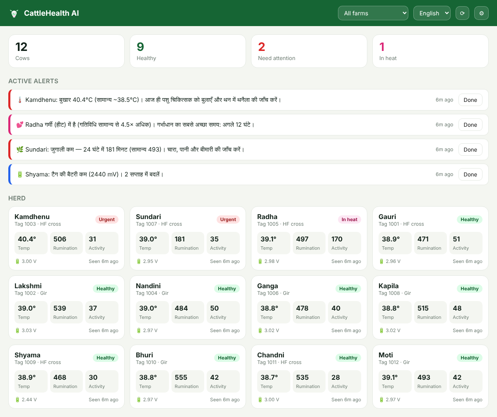

# CattleHealth AI (Pulse Cow Tag)

> **Sub-₹200 Solar BLE Cattle Health Monitoring Tag & WhatsApp AI Platform**  
> *Targeting 300+ Million Unserved Cattle in India & Emerging Markets*

---

## 📌 Executive Summary

**CattleHealth AI** is a disruptive, ultra-low-cost IoT hardware and AI software platform designed to monitor bovine health, body temperature, rumination (chewing), and heat/estrus cycles for smallholder dairy farmers. 

While existing commercial cattle monitors cost **₹4,000 to ₹15,000 per animal**, CattleHealth AI achieves a manufacturing floor cost of **~₹160–₹180 INR ($2.00 USD)**. This allows a zero-friction **"Hardware-as-a-Service" (HaaS)** model: **Free tags for farmers + ₹39/month WhatsApp AI alerts**.

---

## 🛠️ System Architecture

```
┌─────────────────────────────────────────────────────────────────┐
│                      SUB-₹200 BLE SMART TAG                     │
│                                                                 │
│  • PHY6222 / Telink TLSR8251 (BLE 5.0 SoC)                      │
│  • NTC 10K 1% Precision Thermistor Probe (Body Temp)            │
│  • SC7A20 / LIS3DH 3-Axis Accelerometer (Rumination & Heat)     │
│  • CR2477 / ER14505 Battery (1.5 – 2 Year Battery Life)         │
└────────────────────────────────┬────────────────────────────────┘
                                 │ (BLE 5.0 Beacon / 200m Range)
                                 ▼
┌─────────────────────────────────────────────────────────────────┐
│                 FARM GATEWAY & CLOUD ENGINE                     │
│                                                                 │
│  • ESP32 Central Gateway (1 Gateway per 50 cows on farm)         │
│  • AI Cloud Engine (Signal Vector Magnitude & Rumination FFT)   │
└────────────────────────────────┬────────────────────────────────┘
                                 │ (4G / Wi-Fi)
                                 ▼
┌─────────────────────────────────────────────────────────────────┐
│                    FARMER INTERFACE (ZERO APP)                  │
│                                                                 │
│  • WhatsApp Automated Alerts ("Cow #04 has a 103.5°F fever")    │
│  • Offline Progressive Web App (PWA) Dashboard                  │
└─────────────────────────────────────────────────────────────────┘
```

---

## 🧬 Veterinary Science & Detection Algorithms

1. **Fever & Infection Alert**: Monitors relative skin temperature jumps ($\Delta T > +1.0^\circ\text{C}$). Triggers early alerts 24–48 hours before physical milk loss.
2. **Rumination & Digestive Health**: Analyzes 1 Hz chewing harmonic motion. Detects drops in daily rumination below 300 mins/day.
3. **Estrus / Heat Detection**: Computes Signal Vector Magnitude ($a = \sqrt{a_x^2 + a_y^2 + a_z^2}$). Alerts farmer when movement spikes $>3\times$ baseline for artificial insemination window.

---

## 💰 Unit Economics & Financial Projection

| Metric | Amount (INR) | Amount (USD) |
| :--- | :--- | :--- |
| **Manufacturing Floor Cost (BOM + SMT)** | **~₹165 – ₹180** | **~$2.00** |
| **Upfront Cost to Farmer** | **₹0 (FREE Tag)** | **$0.00** |
| **Monthly Subscription Fee** | **₹39 / month** | **~$0.48 / month** |
| **Hardware Payback Period** | **5 Months** | 5 Months |
| **5-Year Lifetime Profit per Cow** | **+₹2,140 Net Profit** | **~$26.00 Net Profit** |

---

## 🚀 Software Stack (this repo)

```
firmware/tag/        Portable C99 tag firmware: NTC temperature, on-tag rumination + activity, BLE payload
firmware/gateway/    ESP32 Arduino gateway: passive BLE scan → de-dup → batched HTTPS upload
cloud/               FastAPI cloud engine: ingest, fever / rumination / heat / device detection, WhatsApp alerts
dashboard/           Offline-capable PWA herd dashboard (English / हिन्दी), served by the cloud app
```



### Run the cloud + dashboard with demo data

```bash
cd cloud
pip install -r requirements.txt
uvicorn cattlehealth.api:app --port 8000          # dashboard at http://localhost:8000
python -m cattlehealth.simulate --url http://localhost:8000 --cows 12 --days 8
```

The simulator creates a farm, 12 named cows and 8 days of 15-minute readings with four injected
events — a fever, a cow in heat, a rumination drop and a low battery — all of which are detected and alerted.

Or with Docker: `docker build -t cattlehealth . && docker run -p 8000:8000 -v ch-data:/data cattlehealth`

### Configuration (environment variables, see `.env.example`)

| Variable | Purpose |
| --- | --- |
| `CH_DB_PATH` | SQLite file (default `cattlehealth.db`) |
| `CH_GATEWAY_KEYS` | Comma-separated keys accepted from gateways on `/api/v1/ingest` |
| `CH_API_KEY` | If set, required as `X-API-Key` for dashboard/admin API (enter it under ⚙ in the dashboard) |
| `WHATSAPP_TOKEN`, `WHATSAPP_PHONE_NUMBER_ID` | Meta WhatsApp Cloud API. Unset = dry-run, alerts are logged |
| `WHATSAPP_VERIFY_TOKEN` | Webhook verification token for `/webhook/whatsapp` |
| `CH_ALERT_COOLDOWN_H` | Hours before the same alert kind repeats for a cow (default 12) |

### API

| Method | Path | |
| --- | --- | --- |
| POST | `/api/v1/ingest` | Gateway upload (`X-Gateway-Key`) |
| GET/POST | `/api/v1/farms` | List / create farms (owner WhatsApp number + language `en hi mr gu ta`) |
| POST | `/api/v1/gateways/{id}/farm/{farm_id}` | Assign a gateway (and its cows) to a farm |
| GET/POST | `/api/v1/cows` | Herd with live status · register / name a tag |
| GET/PATCH | `/api/v1/cows/{tag_id}` | Detail: 72 h series, 7-day rumination, alerts · rename |
| GET | `/api/v1/alerts?active=true` | Alerts · `POST /api/v1/alerts/{id}/ack` to acknowledge |
| POST | `/api/v1/sweep` | Offline-tag check (also runs every 10 min) |
| GET/POST | `/webhook/whatsapp` | Meta webhook — farmer sends any message, gets a herd summary back |

Interactive docs: `http://localhost:8000/docs`

### Detection rules (`cloud/cattlehealth/detection.py`)

| Alert | Rule |
| --- | --- |
| Fever | Two consecutive readings ≥ cow's 3-day median baseline + 1.0 °C, or ≥ 39.8 °C. Critical at ≥ 40.5 °C or +1.5 °C |
| Hypothermia | Two consecutive readings ≤ 37.5 °C (milk fever) |
| Rumination | 24 h total < 300 min, or < 70 % of the cow's 7-day median (needs ≥ 80 % report coverage). Critical < 200 min |
| Heat / estrus | 3 h mean activity ≥ 3 × the cow's 7-day median |
| Device | Low battery (< 2.5 V), strap tamper, no signal for 2 h |

### Firmware

```bash
make -C firmware/tag test      # host-side unit tests with a simulated HAL
```

The tag code is SoC-independent; port it by implementing `firmware/tag/src/hal.h` with the PHY6222 or
Telink SDK. The gateway sketch (`firmware/gateway/cattle_gateway/`) needs NimBLE-Arduino ≥ 2.0 and
ArduinoJson ≥ 7 — copy `config.example.h` to `config.h` and set Wi-Fi, server URL and gateway key.

### Tests

```bash
cd cloud && python -m pytest -q   # detection + API end-to-end
```

CI runs both suites on every push (`.github/workflows/ci.yml`).

> Alert translations (Hindi, Marathi, Gujarati, Tamil) are in `cloud/cattlehealth/messages.py` and should be
> reviewed by native speakers and a veterinarian before field deployment.

---

## 📄 Documentation

For the complete technical breakdown, bill of materials, manufacturing workflow in India, and government grant strategies, see:
* [PROJECT_SPECIFICATION.md](PROJECT_SPECIFICATION.md)
* [docs/BLE_PAYLOAD.md](docs/BLE_PAYLOAD.md) — tag advert format and gateway → cloud JSON

---

## 🇮🇳 Make in India Manufacturing Workflow

* **PCB Fabrication & SMT Assembly**: Bengaluru / Noida / Pune / Gujarat (LionCircuits, Sahasra, PCB Power).
* **Enclosure Molding**: Local plastic injection molding (Pune / Rajkot).
* **Grants & Funding**: Eligible for BIRAC BIG Grant (up to ₹50 Lakhs), NABARD Agri-Innovation Fund, and DPIIT Startup India.
